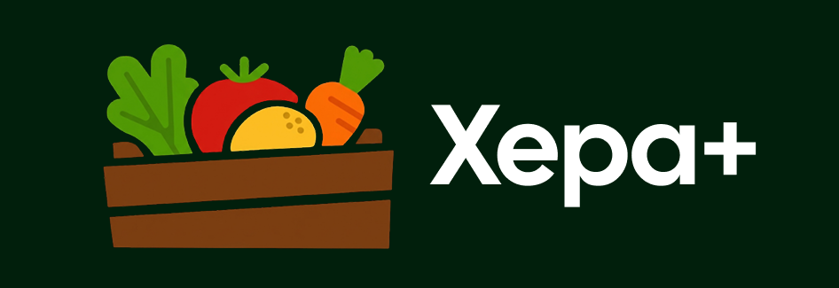
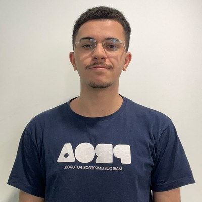
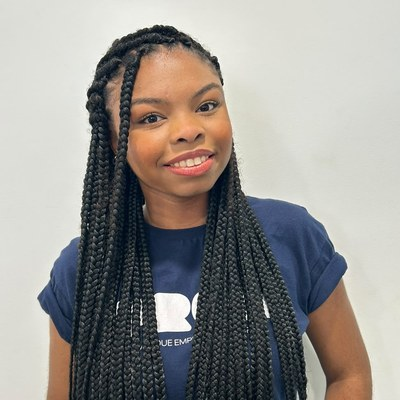
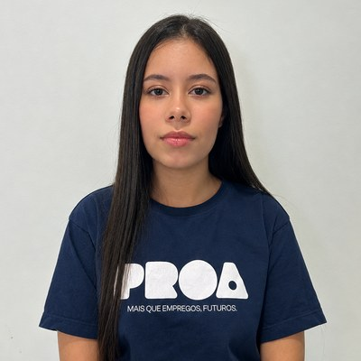
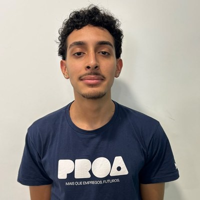
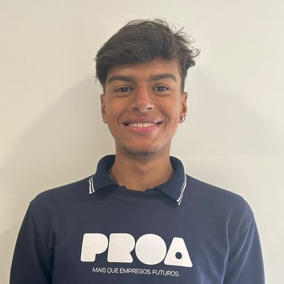

  

**Conectamos feirantes e consumidores para que o alimento da feira chegue à mesa, e não ao lixo.**

[Apresentação](#apresentação-do-projeto) · [Sobre](#quem-somos) · [Problema](#contexto-e-problema) · [ODS](#impacto-nos-ods) · [Funcionalidades](#funcionalidades) · [Tecnologias](#tecnologias) · [Identidade visual](#identidade-visual) · [Time](#conheça-nosso-time)

## Xepa Mais

O **Xepa+** é uma plataforma digital que conecta feirantes a consumidores interessados em comprar frutas, verduras e legumes que sobraram ao final das feiras livres por preços mais acessíveis. A proposta busca reduzir o desperdício de alimentos, diminuir as perdas financeiras dos feirantes e facilitar o acesso da população a produtos frescos com preços menores.

A plataforma permite divulgar produtos, apresentar ofertas, aproximar consumidores dos feirantes e facilitar a localização de feiras com alimentos disponíveis. O projeto também considera recursos para cadastro de produtos, carrinho, pedidos, pagamento, mapa de feiras, receitas, área financeira e funcionalidades relacionadas à inteligência artificial.

> **Fase inicial:** o foco está na validação do modelo em uma ou duas feiras da região da Brasilândia e da Freguesia do Ó, na Zona Norte de São Paulo.

## Quem somos

O **Xepa+** é um projeto acadêmico contra o desperdício de alimentos nas feiras livres e na CEAGESP, na cidade de São Paulo. Somos estudantes que se uniram para dar um novo destino à **xepa**: os alimentos que sobram no fim da feira e que ainda estão ótimos para o consumo. O nome vem da prática em que os feirantes baixam os preços no fim do dia para vender o que sobrou.

### Missão
Dar um novo destino ao que sobra da feira, reduzindo o desperdício de frutas, verduras e legumes e tornando esses alimentos mais acessíveis.

### Visão
Ser referência no aproveitamento pós-feira, com um modelo sustentável, acessível e eficiente para consumidores, feirantes e parceiros.

### Valores
- **Sustentabilidade:** alimento bom não vira lixo.
- **Acessibilidade:** comida de qualidade a preço justo.
- **Compromisso social:** cuidado com quem vive da feira e com quem depende dela.

## Contexto e problema

Ao final das feiras livres, muitos feirantes ainda possuem frutas, verduras e legumes que não foram vendidos. Mesmo quando esses alimentos continuam próprios para consumo, parte deles pode acabar sendo descartada por falta de compradores ou de alternativas para a comercialização.

**O principal problema é a dificuldade de comercializar rapidamente os alimentos que sobram no final das feiras, mesmo quando ainda podem ser consumidos.**

Essa situação representa uma oportunidade de reduzir as perdas financeiras dos comerciantes e facilitar o acesso da população a alimentos mais baratos. O Xepa+ surge para conectar essas duas necessidades por meio de uma plataforma digital que permite divulgar produtos, apresentar ofertas e aproximar consumidores dos feirantes.

### O desperdício na feira é maior do que parece

- **33 mil toneladas** de alimentos vão para o lixo por ano nas feiras da capital paulista.
- Esse volume permitiria que **19 milhões de brasileiros** fizessem 3 refeições ao dia.
- **95% dos feirantes** relatam desperdício no fim da feira.

Fonte: estudo da Unesp sobre o desperdício de alimentos nas feiras livres de São Paulo.

## Impacto nos ODS

O Xepa+ contribui com três Objetivos de Desenvolvimento Sustentável da ONU:

**ODS 2 - Fome Zero e Agricultura Sustentável** 
Facilita o acesso a frutas, verduras e legumes por preços mais acessíveis, aproveitando alimentos que sobraram ao final das feiras livres.

**ODS 8 - Trabalho Decente e Crescimento Econômico** 
Apoia os pequenos comerciantes com um canal digital para divulgar produtos e atrair consumidores, contribuindo para reduzir perdas financeiras e gerar oportunidades de renda.

**ODS 12 - Consumo e Produção Responsáveis** 
Reduz o desperdício de alimentos e incentiva o consumo consciente, a utilização mais eficiente dos recursos e a adoção de práticas mais sustentáveis.

## Funcionalidades

### Para o consumidor
- Vitrine de xepas disponíveis perto de você
- Mapa das feiras livres da cidade
- Carrinho, pagamento e histórico de pedidos
- Chat direto com o feirante
- Painel de impacto: quanto alimento você salvou
- Receitas para aproveitar cada alimento

### Para o feirante
- Cadastro de feiras e produtos
- Controle financeiro de rendas e gastos, com exportação em PDF
- Histórico de vendas e de produtos
- **Xep.AI**, assistente com inteligência artificial para o dia a dia da banca (planos Crescer e Pro)
- Planos de assinatura: Grátis, Crescer e Pro

## Tecnologias

**Front-end:** 

**Back-end e banco de dados:** 

**Ferramentas:** 

## Conheça nosso time

Estudantes de diferentes áreas com um mesmo objetivo: levar o alimento da feira à mesa, e não ao lixo.

<table>
  <tr>
    <td align="center" width="25%">
       
      <h3>Gabriel Carneiro</h3>
      Product Owner 
      Marketing  
      <a href="https://www.linkedin.com/in/gabriel-carneiro-5459b6303/">LinkedIn</a> · <a href="https://github.com/carneirogabri">GitHub</a>
       
    </td>
    <td align="center" width="25%">
       
      <h3>Jamilly Moreira</h3>
      Scrum Master 
      Vendas  
      <a href="https://www.linkedin.com/in/jamillymoreira/">LinkedIn</a> · <a href="https://github.com/milly-m-dev">GitHub</a>
       
    </td>
    <td align="center" width="25%">
       
      <h3>Fernanda Ribeiro</h3>
      Documentarista 
      Financeiro  
      <a href="https://www.linkedin.com/in/f3f3h/">LinkedIn</a> · <a href="https://github.com/f3f3h">GitHub</a>
       
    </td>
    <td align="center" width="25%">
       
      <h3>Hadson de Jesus</h3>
      Desenvolvedor 
      Vendas  
      <a href="https://www.linkedin.com/in/hadson-ferreira-068088271/">LinkedIn</a> · <a href="https://github.com/fhadson">GitHub</a>
       
    </td>
  </tr>
  <tr>
    <td align="center" width="25%">
       
      <h3>Henrique Mazza</h3>
      Desenvolvedor 
      IA  
      <a href="https://www.linkedin.com/in/henriquemazzavalle/">LinkedIn</a> · <a href="https://github.com/HenriqueMazza">GitHub</a>
    </td>
    <td align="center" width="25%">
       
      <h3>Igor Aguiar</h3>
      Desenvolvedor 
      Dados  
      <a href="https://www.linkedin.com/in/igor-aguiar-ab193132b/">LinkedIn</a> · <a href="https://github.com/Igordevice">GitHub</a>
    </td>
    <td align="center" width="25%">
       
      <h3>Matheus Barros</h3>
      Desenvolvedor 
      Dados  
      <a href="https://www.linkedin.com/in/matheus-barros-13b652330/">LinkedIn</a> · <a href="https://github.com/MatheusSouzaBarros">GitHub</a>
    </td>
    <td align="center" width="25%">
       
      <h3>Murilo Verissimo</h3>
      Desenvolvedor 
      Marketing  
      <a href="https://www.linkedin.com/in/murilo-verissimo-44a958372/">LinkedIn</a> · <a href="https://github.com/verissimoMuh">GitHub</a>
    </td>
  </tr>
</table>

## Agradecimentos

Às nossas famílias, aos professores e orientadores e aos feirantes que abriram suas bancas para a gente. Este projeto também é de vocês.

  Feito pelo time Xepa+ · São Paulo

